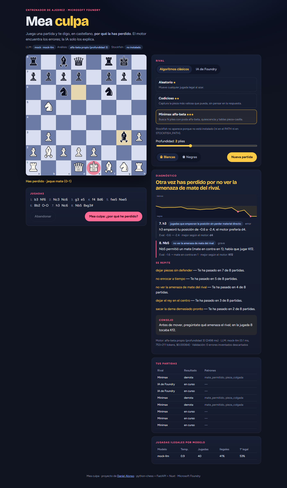
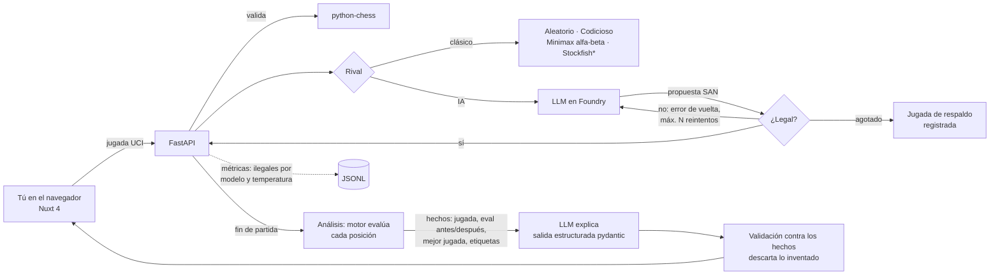
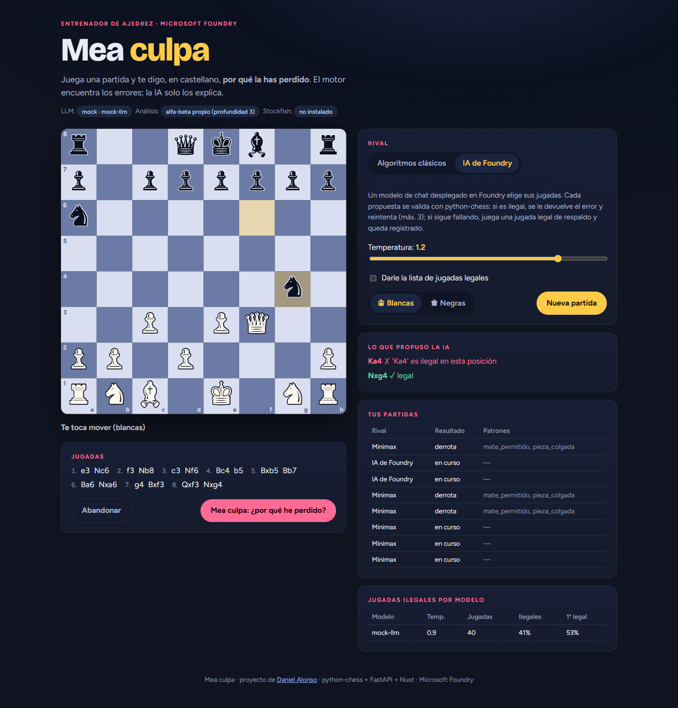

# Mea culpa

> «Otra vez has perdido por no enrocar a tiempo.»

Un entrenador de ajedrez que, al acabar la partida, te dice **en castellano y sin rodeos por qué has perdido**. Lo que dice
no se lo inventa: un motor de ajedrez encuentra los errores y un LLM desplegado en **Microsoft Foundry** solo los
explica.



## El problema

Los programas de ajedrez te enseñan una evaluación (`-3.2`) y una línea de 12 jugadas. Eso no le sirve a quien está
aprendiendo. Un LLM sí sabe explicar, pero juega fatal y analiza peor: se inventa variantes, piezas y jugadas que no
existen. Mea culpa separa las dos cosas:

- **El motor decide qué pasó** (evaluaciones, mejor jugada, qué pieza quedó colgada).
- **El LLM solo lo cuenta**, en una frase por error, y agrupa los patrones que se repiten en tus partidas.
- **Todo lo que dice el LLM se valida contra los hechos del motor**; lo que no esté respaldado se descarta y se cuenta.

## Resultados (lo que hay medido hoy)

Todo lo de abajo se ha medido **en modo mock** (sin Azure), así que valida el *pipeline*, no la calidad de un modelo.
El script de evaluación está listo para repetirse contra un modelo real de Foundry (ver [Evaluación](#evaluación)).

| Qué | Resultado |
|---|---|
| Tests | **36 tests en verde** (`pytest`): validación de jugadas, reintentos/fallback, mates en 1 y 2, detección de errores, validación de la salida del LLM, API y cliente de Azure con red simulada |
| Detección de errores en partidas históricas | En las miniaturas, la mayor caída del motor es el error clásico: **5…Bxd1??** en el mate de Légal, **2.g4??** en el mate del loco, **3…Nf6??** en el del pastor. En las partidas largas, el alfa-beta a profundidad 3 no siempre coincide con el análisis histórico (en la Siempreviva marca 7…d3 y no 19…Qxf3); con Stockfish sería más fiable |
| Jugadas ilegales del LLM (mock) | 4,8 % a temperatura 0 · 24,5 % a 0,7 · 48,1 % a 1,2 — sin una sola jugada ilegal en el tablero gracias a la validación con python-chess |
| Coste por diagnóstico | ~750 tokens de entrada + ~200 de salida ≈ **0,0005 $** con precios tipo gpt-4.1-mini (estimado; configurable) |
| Análisis con el motor propio | 0,2 s – 30 s por partida según su longitud (Python puro, profundidad 3) |

La tabla completa está en [`eval/resultados_mock.md`](eval/resultados_mock.md).

## Cómo funciona



\* Stockfish solo aparece si ya está instalado (ver abajo).

### Dos formas de jugar

1. **Tú contra una IA de Foundry.** Un modelo de chat elige sus jugadas. Cada propuesta pasa por python-chess: si es
   ilegal o no se entiende, se le devuelve el error («'Ke9' es ilegal en esta posición») y vuelve a intentarlo, hasta
   `LLM_MAX_RETRIES` veces (3 por defecto). Si sigue fallando, se juega una jugada legal de respaldo y queda apuntado.
   Cada intento se registra para medir **cuántas jugadas ilegales propone cada modelo a cada temperatura**; la página
   lo muestra en una tabla. Opcionalmente se le puede dar la lista de jugadas legales para comparar.
2. **Tú contra algoritmos clásicos**, de menos a más fuerte:
   - *Aleatorio*: cualquier jugada legal.
   - *Codicioso*: captura lo más valioso que pueda (y da mate en una si lo ve).
   - *Minimax alfa-beta*: negamax con poda alfa-beta, profundización iterativa, quiescencia sobre capturas, tabla de
     transposiciones, ordenación MVV-LVA + killer moves y evaluación de material + tablas pieza-casilla. Profundidad
     configurable (1–4).
   - *Stockfish* con nivel 0–20, **solo si hay un binario `stockfish` en el PATH o en `STOCKFISH_PATH`**. El proyecto no
     descarga binarios; si no lo encuentra, la opción no aparece (en este equipo no estaba instalado, así que esa parte
     no se ha probado).



### El análisis «mea culpa»

1. Se evalúa cada posición de la partida: con Stockfish si está, si no con el alfa-beta propio a profundidad fija.
   La posición *antes* de tu jugada se busca un ply más que la de *después*, así el horizonte es el mismo y jugar la
   mejor jugada siempre da caída 0.
2. Para cada jugada tuya: `caída = eval(antes) − eval(después)` desde tu punto de vista (recortada a ±10 peones).
   ≥ 3 peones es *grave*, ≥ 1,5 *error*, ≥ 0,7 *imprecisión*.
3. Cada error se etiqueta con reglas deterministas: `mate_permitido`, `mate_no_visto`, `pieza_colgada` (la mejor
   respuesta del rival captura una pieza tuya indefensa o atacada por otra de menos valor), `cambio_desfavorable`,
   `oportunidad_perdida`, `dama_prematura`, `rey_en_el_centro`, `enroque_tardio`, `error_posicional`.
4. El LLM recibe solo esos hechos (más los recuentos de patrones de tus partidas anteriores) y devuelve, con salida
   estructurada pydantic, una frase por error, el error principal, los patrones recurrentes y un consejo.
5. La salida se valida: errores en jugadas que no están en los hechos, patrones que el motor no detectó o patrones
   «recurrentes» sin respaldo en el historial **se descartan y se cuentan** (se ven en la página y en la evaluación).

El PGN y cualquier texto del usuario son **datos no fiables**: van entre etiquetas (`<partida_pgn>`, `<hechos_motor>`),
se les quitan `<` y `>` para que no puedan cerrar las etiquetas, se exportan sin comentarios y el prompt de sistema
dice explícitamente que cualquier instrucción dentro de ellos se ignora.

## Ejecutarlo en local (modo mock, sin Azure)

Requisitos: Python 3.11+ y Node 20+.

```bash
# API
python -m venv .venv
.venv/Scripts/python -m pip install -r requirements-dev.txt        # en Linux/macOS: .venv/bin/python
.venv/Scripts/python -m uvicorn meaculpa.main:create_app --factory --app-dir backend --port 8000

# Frontend (otra terminal)
cd web
npm install
npm run dev            # http://localhost:3000
```

Por defecto `LLM_PROVIDER=mock`: un proveedor simulado que lee los mismos prompts que vería el modelo real (FEN, hechos
del motor) y responde con el mismo esquema. Para jugar propone a veces jugadas ilegales (más cuanta más temperatura),
y para el diagnóstico rellena plantillas en español con los hechos. Sirve para probarlo todo de punta a punta, no para
juzgar la calidad de las explicaciones.

Las partidas y métricas se guardan en `data/runtime/` (ignorado por git).

```bash
.venv/Scripts/python -m pytest -q        # tests
.venv/Scripts/python -m ruff check .     # lint
```

## Apuntarlo a Microsoft Foundry

1. Despliega un modelo de chat en un recurso de Foundry / Azure OpenAI (o usa `infra/main.bicep`).
2. Date el rol **Cognitive Services OpenAI User** sobre el recurso y haz `az login`.
3. Variables de entorno:

```bash
LLM_PROVIDER=azure
AZURE_OPENAI_ENDPOINT=https://<tu-recurso>.openai.azure.com/
AZURE_OPENAI_DEPLOYMENT=<nombre-del-deployment>
# Opcionales
AZURE_OPENAI_API_VERSION=        # vacío = API v1 (/openai/v1/), recomendado; o p. ej. 2024-10-21 para el cliente clásico
AZURE_OPENAI_API_KEY=            # solo si no puedes usar Entra ID
AZURE_OPENAI_SUPPORTS_TEMPERATURE=true   # false para modelos de razonamiento que no aceptan temperature
LLM_PRICE_INPUT_PER_M=0.40       # USD por millón de tokens, para calcular el coste
LLM_PRICE_OUTPUT_PER_M=1.60
```

El proveedor (`backend/meaculpa/llm/azure.py`) usa el SDK oficial `openai`: con la API v1, el cliente `OpenAI` con
`base_url={endpoint}/openai/v1/`; con `api-version`, el cliente `AzureOpenAI`. La autenticación por defecto es
**Entra ID** (`DefaultAzureCredential` + `get_bearer_token_provider`, ámbito `https://cognitiveservices.azure.com/.default`):
en local usa tu `az login` y en Azure la identidad administrada (`AZURE_CLIENT_ID`). La API key es solo un plan B.
Las llamadas usan `chat.completions.parse(response_format=<modelo pydantic>)`.

Los tests comprueban este cliente sin red: un transporte HTTP falso verifica la URL, la cabecera `Authorization: Bearer`,
el `response_format` JSON Schema y el parseo. **No se ha probado contra un recurso real de Azure.**

Otras variables: `STOCKFISH_PATH`, `ANALYSIS_DEPTH` (3), `STOCKFISH_ANALYSIS_DEPTH` (14), `LLM_MAX_RETRIES` (3),
`MEA_CULPA_DATA_DIR`, `CORS_ORIGINS`, `APPLICATIONINSIGHTS_CONNECTION_STRING` (+ paquete `azure-monitor-opentelemetry`).

## Evaluación

```bash
.venv/Scripts/python backend/scripts/evaluate.py                       # mock
LLM_PROVIDER=azure AZURE_OPENAI_ENDPOINT=... AZURE_OPENAI_DEPLOYMENT=... \
  .venv/Scripts/python backend/scripts/evaluate.py --temps 0 0.7 1.2   # modelo real
```

Sobre las partidas de `data/pgn/` (la Inmortal 1851, la Siempreviva 1852, la de la Ópera 1858, el mate de Légal y dos
miniaturas de ejemplo; todas de dominio público) mide:

- con qué frecuencia el **error principal que nombra el LLM coincide con la mayor caída del motor**;
- si el patrón que elige está entre las etiquetas del motor;
- cuántos errores inventa (descartados por la validación);
- latencia y coste por análisis;
- **tasa de jugadas ilegales por modelo y temperatura**, jugada legal a la primera y fallbacks.

Escribe la tabla en `eval/resultados_<proveedor>.md`. En mock la coincidencia es 100 % por construcción (el mock elige
siempre la mayor caída); el número interesante saldrá al ejecutarlo contra uno o varios deployments de Foundry.

## Infraestructura como código (escrita, no desplegada)

`infra/main.bicep` + `infra/main.bicepparam` (compilan sin avisos con `az bicep build` y `az bicep lint`):

- **Azure Container Apps** (plan Consumption) para la API, `minReplicas: 0` → escala a cero.
- **Recurso de Microsoft Foundry** (`Microsoft.CognitiveServices/accounts`, kind `AIServices`) con `disableLocalAuth`
  y un **deployment del modelo** (`gpt-4.1-mini`, GlobalStandard, 10K TPM; parametrizable).
- **Identidad administrada** asignada por el usuario con el rol *Cognitive Services OpenAI User* sobre ese recurso.
- **Log Analytics + Application Insights** (con tope diario de ingesta de 1 GB).
- **Static Web Apps (Free)** para el frontend (`nuxt generate` → `web/.output/public`).
- **Presupuesto mensual** con alertas al 50 % y 90 % (real) y al 100 % (previsto).

`Dockerfile` para la imagen de la API (no construida ni publicada). No incluye un Azure Container Registry para no
sumar su coste fijo; la idea es publicar la imagen en GHCR.

```bash
# Cuando decidas pagar (NO se ha ejecutado):
az group create -n rg-mea-culpa -l swedencentral
az deployment group create -g rg-mea-culpa -f infra/main.bicep -p infra/main.bicepparam
```

**Coste estimado** para una demo de portfolio (pocas partidas al día), con precios de referencia que conviene revisar
en la calculadora de Azure antes de desplegar:

| Recurso | Estimación mensual |
|---|---|
| Container Apps (escala a cero, dentro de la concesión gratuita mensual) | ~0 € |
| Log Analytics / App Insights (bajo la franja gratuita de 5 GB) | ~0 € |
| Static Web Apps Free | 0 € |
| Foundry: tokens (≈0,0005 $ por diagnóstico, ≈0,005 $ por partida contra el LLM) | < 1 € con 100 partidas |
| **Total** | **~0–2 €/mes** |

Ojo: el presupuesto **avisa, no corta**. El tope real lo ponen los 10K TPM del deployment y el escalado máximo a 2 réplicas.

## Decisiones de diseño

- **Por qué validar con python-chess.** Un LLM no tiene estado del tablero: propone jugadas en texto. python-chess es la
  fuente de verdad de las reglas (enroque, al paso, clavadas, ahogado). El servidor nunca aplica una jugada que no haya
  pasado por `board.legal_moves`, venga del usuario, del LLM o de un motor.
- **Por qué devolverle el error al LLM en vez de descartarlo sin más.** Medir cómo se corrige con feedback es más
  informativo que una tasa de fallos bruta, y es lo que se haría en producción. El fallback garantiza que la partida
  sigue y queda registrado para que no maquille la métrica.
- **Por qué el LLM solo explica hechos del motor.** Es el patrón de *grounding* de cualquier sistema RAG serio aplicado al
  ajedrez: el modelo es bueno redactando y malo calculando. Darle hechos cerrados, pedir salida estructurada y validarla
  después convierte las alucinaciones en un número medible (errores inventados descartados).
- **Por qué alfa-beta propio.** Porque Stockfish no siempre está y no se deben descargar binarios, y porque demuestra
  la base: negamax + poda + quiescencia + tabla de transposiciones en ~200 líneas legibles. Es lento (Python puro) y
  débil comparado con Stockfish, pero suficiente para ver piezas colgadas y mates cortos, que es lo que pierde partidas
  a nivel aficionado.
- **Por qué patrones deterministas.** «Has vuelto a dejar el rey en el centro» solo es honesto si se puede contar. Las
  etiquetas salen de reglas sobre el tablero, se guardan por partida y el LLM recibe los recuentos; no puede decir
  «otra vez» si el historial no lo respalda.
- **Proveedor detrás de una interfaz.** `structured(messages, schema, temperature)` es toda la superficie. El mock
  permite tests y demo sin cuenta de Azure; cambiar de modelo es cambiar una variable de entorno.

## Qué falta

- **No se ha probado contra Azure real**: ni el modelo de Foundry, ni el despliegue Bicep, ni la imagen Docker. Las
  cifras de calidad del LLM están por medir.
- Stockfish no estaba instalado en el equipo de desarrollo: el rival y el analizador con Stockfish están escritos pero sin probar.
- El análisis con el motor propio puede tardar ~30 s en partidas largas; se podría paralelizar por posiciones o pasar a Stockfish.
- Persistencia en ficheros JSON y para un único usuario; en Container Apps el disco es efímero (habría que usar
  Table Storage o Cosmos DB) y no hay autenticación.
- Las etiquetas de patrones son heurísticas sencillas (no detectan clavadas, horquillas, debilidades de peones…).
- El frontend no tiene arrastrar y soltar ni reloj; la promoción se elige con un selector simple.
- La CI (`.github/workflows/ci.yml`: ruff + pytest) está escrita pero el repo no tiene remoto, así que nunca se ha ejecutado en GitHub.

## Estructura

```
backend/meaculpa/
  engines/        evaluación (material + PST), alfa-beta, rivales clásicos, detección de Stockfish
  llm/            interfaz, proveedor Azure/Foundry, mock
  llm_player.py   rival LLM: validación, reintentos, fallback, métricas
  analysis.py     análisis mea culpa: evaluaciones, caídas, etiquetas, diagnóstico y validación
  prompts.py      prompts y saneado de datos no fiables
  schemas.py      esquemas pydantic de la salida del LLM
  games.py        partidas y persistencia
  main.py         API FastAPI
backend/tests/    pytest
backend/scripts/evaluate.py
data/pgn/         partidas de muestra
web/              Nuxt 4 + Vue 3
infra/            Bicep
eval/             resultados de la evaluación
```

---

Proyecto de [Daniel Alonso](https://danielalonso.dev).
